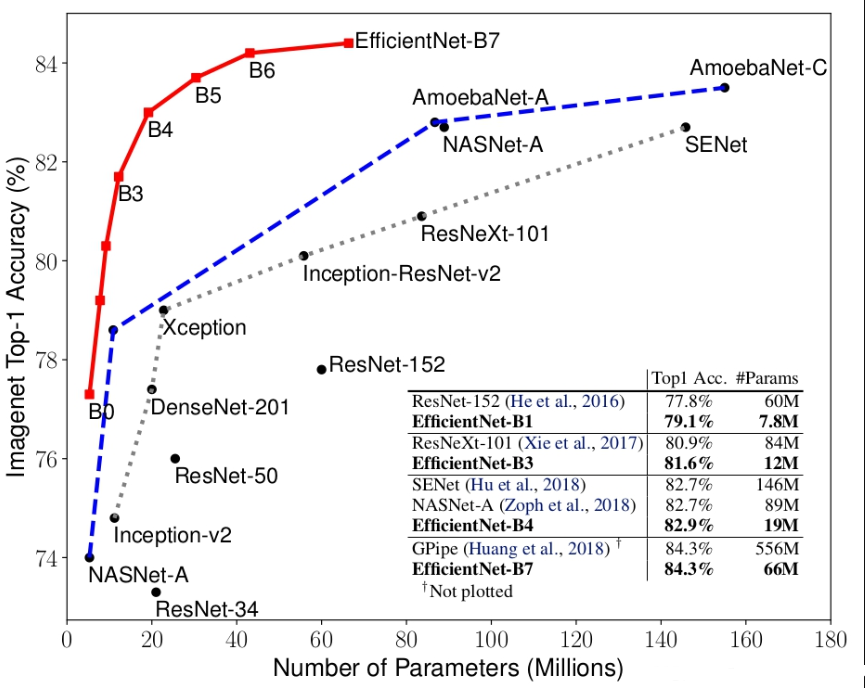
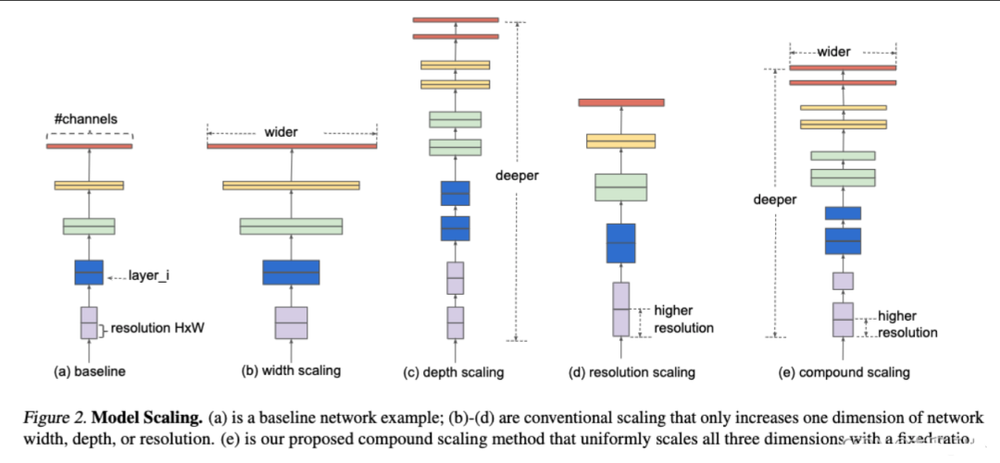
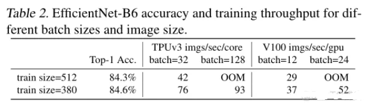
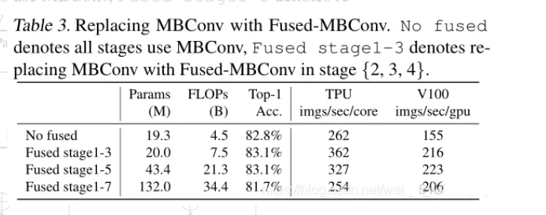
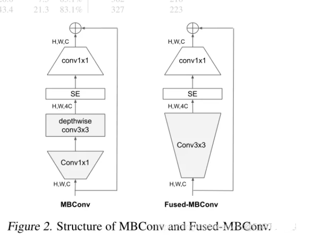
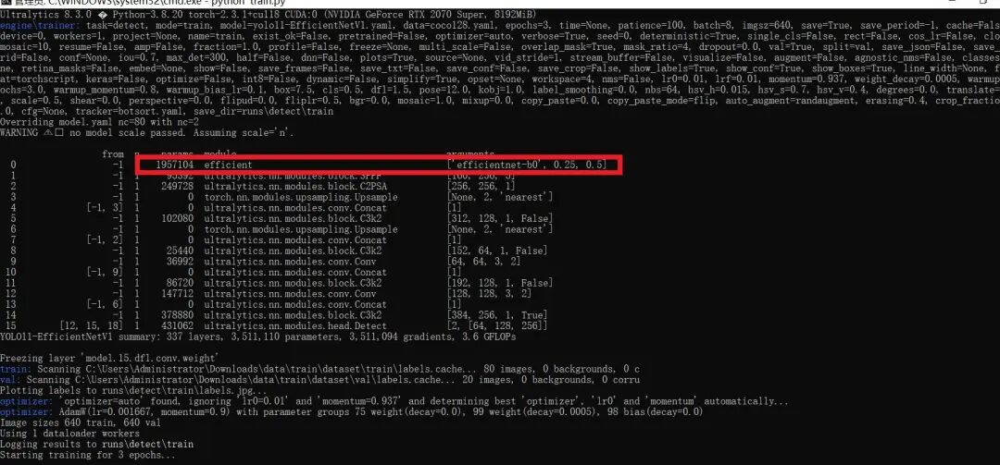

# [yolov11 Improvement Series] Python source code for replacing the backbone with EfficientNetV1 or EfficientNetV2 using EfficientNetV1 or EfficientNetV2

[EfficientNetV1 Introduction]

1. EfficientNet V1 Neural Network Introduction
EfficientNet is a neural network architecture proposed by Google, which aims to balance computational resources and accuracy by scaling the width (number of channels), height (depth), and depth (number of layers) of the network proportionally. EfficientNet employs a method called "compound scaling," which dynamically adjusts the width, height, and depth of the network based on model size and training data volume to achieve optimal performance. This scaling method allows the model to adapt itself according to available computational resources and data volume, achieving good results across different hardware and datasets.

In the paper, it is mentioned that the EfficientNet-B7 proposed in this paper achieved the highest accuracy of 84.3% on Imagenet top-1, which is only 1/8.4 compared to the previous highest accuracy GPipe, and its inference speed increased by 6.1 times.

 Edit

The main features of EfficientNet are as follows:

Compound scaling method:

EfficientNet dynamically adjusts the width, height, and depth of the network based on the amount of training data and computational resources. It uses a fixed scaling factor to simultaneously scale the network's width, depth, and resolution to find the optimal resource allocation strategy.
Inverted residual blocks styled after MobileNetV2:

EfficientNet employs inverted residual blocks similar to MobileNetV2 as its fundamental building block, which includes group convolution and linear bottleneck structures, along with the Squeeze-and-Excitation attention mechanism.

EfficientNet utilizes AutoML technology to determine the optimal network architecture, and automatically searches for the best scaling factor through automated search.
Mixed-Precision Training:

EfficientNet utilizes a mixed-precision training technique, which involves using both half-precision (FP16) and single-precision (FP32) data types for training, to accelerate the training process and save memory on GPUs.
Gradient Bandwidth Reduction:

To avoid the issues of gradient explosion or vanishing, EfficientNet applies gradient bandwidth reduction technology, a version of gradient clipping.
EfficientNet has multiple variants, ranging from EfficientNet-B0 to EfficientNet-B7, with increasing scales and correspondingly improved performance. These variants are generated through compound scaling methods, with B0 being the base model, while other variants expand the scale of B0 by increasing width, depth, and input image resolution.

The success of EfficientNet lies in its ability to maintain high accuracy while significantly reducing model size and computational requirements, making it particularly useful for resource-constrained environments such as mobile devices. Due to its excellent performance and efficiency, EfficientNet has become one of the popular choices in computer vision tasks.

The following figure presents the structural diagram of the model. Figure a is a traditional convolutional neural network, while figures b, c, and d are modifications to the network's width (i.e., the number of channels in the feature matrix), depth (the number of layers), and input resolution (i.e., the height and width of the input, which will subsequently increase the height and width of all feature matrices), respectively. Figure e represents the consideration of simultaneously increasing the network's width, depth, and input resolution as discussed in this paper.

 Edit

[EfficientNetV2 Introduction]

EfficientNetV2 was published in CVPR in April 2021, with its original paper being EfficientNetV2: Smaller Models and Faster Training. The following figure shows the performance of EfficientNetV2, which is divided into S, M, L, XL versions. After pre-training on ImageNet 21k, the parameters are transferred to ImageNet 1k classification, achieving a very high accuracy. Compared to ViT, the performance after pre-training is also lower by nearly two points, and the training speed will be slower.

EfficientNetV1's shortcomings:

Training with very large image sizes is slow. It also tends to cause Out Of Memory errors.

 Edit

Depthwise convolutions are slow in the early layers. DW convolutions have fewer parameters and failures than conventional convolutions, but they often cannot fully leverage modern accelerators. The partial combination of Fused-MBConv with MBConv works well (as shown in the figure below, best results are achieved using Fused-MBConv for layers 1-3 while other layers use MBConv).

 Edit

The structural diagrams of both:

 Edit

Equally, expanding each stage is suboptimal. EfficientNetV2 will employ a non-uniform scaling strategy, gradually adding more layers to the later stages. It also slightly modifies the scaling rules, limiting the maximum size of images to smaller values.
Contributions of EfficientNetV2:

Proposes EfficientNetV2, a new series of smaller and faster models. Through our training on NAS and scaling, EfficientNetV2 outperforms previous models in both training speed and parameter efficiency.
Proposes an improved progressive learning method that adaptively adjusts regularization and image size. Trials show it accelerates training while improving accuracy.
Demonstrates 11x faster training speed and 6.8x higher parameter efficiency than existing techniques on ImageNet, CIFAR, Cars, and Flowers datasets.
Key work of EfficientNetV2:

Focus on training speed and parameter quantity.
For small-sized images, use low-intensity regularization; for large-sized images, use high-intensity regularization, which improves accuracy and realizes adaptive regularization operations.
Optimize training speed and parameter efficiency using NAS search technology.

[Introduction to YOLOv11 Framework]

On September 30, 2024, Ultralytics officially released YOLOv11 during its event YOLOVision. YOLOv11 is the latest version of YOLO, developed by the team from both the United States and Spain, Ultralytics. YOLO stands for You Only Look Once, a computer vision algorithm used in image-based artificial intelligence.

### Ultralytics YOLO11 Overview

YOLO11 is the latest version of the Ultralytics YOLO series of real-time object detectors, redefining possibilities with cutting-edge precision, speed, and efficiency. Building on impressive advancements from previous YOLO versions, YOLO11 introduces significant improvements in architecture and training methods, making it a versatile choice for various computer vision tasks.


Editor

Key Features

-

-

Enhanced feature extraction: YOLO11 employs an improved backbone and neck architecture, enhancing feature extraction capabilities to achieve more precise object detection and complex task performance.

-

-

Optimization for efficiency and speed: YOLO11 introduces refined architecture design and optimized training pipelines, providing faster processing speeds while maintaining the best balance between accuracy and performance.

-

-

Achieving higher accuracy with fewer parameters: With the advancement of model design, YOLOv11m has achieved higher average precision (mAP) on the COCO dataset while using 22% fewer parameters than YOLOv8m, thereby improving computational efficiency without compromising accuracy.

-

-

Cross-environment adaptability: YOLO11 can be seamlessly deployed in various environments, including edge devices, cloud platforms, and systems supporting NVIDIA GPUs, ensuring maximum flexibility.

-

-

Supports a wide range of tasks: whether it's object detection, instance segmentation, image classification, pose estimation, or Oriented Object Detection (OBB), YOLO11 aims to tackle various computer vision challenges.

 Edit

#### Compared to previous versions, what are the key improvements in Ultralytics YOLO11?

Ultralytics YOLO11 introduces several significant improvements compared to its predecessor. The main improvements include:

-

-

Enhanced feature extraction: YOLO11 employs an improved backbone and neck architecture, enhancing feature extraction capabilities to achieve more precise object detection.

-

-

Optimized efficiency and speed: Precise architectural design and optimized training pipelines provide faster processing speeds while maintaining a balance between accuracy and performance.

-

-

Achieving higher accuracy with fewer parameters: YOLOv11m achieves higher average precision (mAP) on the COCO dataset, reducing its parameters by 22% compared to YOLOv8m, while improving computational efficiency without compromising accuracy.

-

-

Cross-environment adaptability: YOLO11 can be deployed across various environments, including edge devices, cloud platforms, and systems supporting NVIDIA GPUs.

-

-

Supports a wide range of tasks: YOLO11 supports various computer vision tasks, such as object detection, instance segmentation, image classification, pose estimation, and Oriented Object Detection (OBB).

[Test Environment]

windows10 x64

ultralytics==8.3.0

torch==2.3.1

RTX2070 graphics card with 8GB memory, recommended memory >= 6GB, otherwise it may not be able to train.

[Improvement Process]

1. Add the EfficientNetV1.py and EfficientNetV2.py implementation modules (the code is too extensive, please refer to the improved steps in the __init__.py file under the same directory for the core module source code).

from .EfficientNetV1 import *

from .EfficientNetV2 import *

#### 2. File modification steps

**Modify tasks.py file**

**Create Model Configuration File**

The content of yolo11-EfficientNetV1.yaml is as follows:

```
# Ultralytics YOLO 🚀, AGPL-3.0 license
# YOLO11 object detection model with P3-P5 outputs. For Usage examples see https://docs.ultralytics.com/tasks/detect
# Parameters
nc: 80 # number of classes
scales: # model compound scaling constants, i.e. 'model=yolo11n.yaml' will call yolo11.yaml with scale 'n'
  # [depth, width, max_channels]
  n: [0.50, 0.25, 1024] # summary: 319 layers, 2624080 parameters, 2624064 gradients, 6.6 GFLOPs
  s: [0.50, 0.50, 1024] # summary: 319 layers, 9458752 parameters, 9458736 gradients, 21.7 GFLOPs
  m: [0.50, 1.00, 512] # summary: 409 layers, 20114688 parameters, 20114672 gradients, 68.5 GFLOPs
  l: [1.00, 1.00, 512] # summary: 631 layers, 25372160 parameters, 25372144 gradients, 87.6 GFLOPs
  x: [1.00, 1.50, 512] # summary: 631 layers, 56966176 parameters, 56966160 gradients, 196.0 GFLOPs
# Below [-1, 1, efficientnet-b0], [efficientnet-b0, 0.25, 0.5]], the parameter position 0.25 represents the coefficient for channel scaling. The YOLOv11N is set to 0.25, YOLOv11S to 0.5, YOLOv11M to 1, and YOLOv11L to 1. You can adjust these according to the version of YOLO you are training with.
# 0.5 corresponds to the depth coefficient of the model
# efficientnet-b0 is the version of the model.
# Supported versions:
#     'efficientnet-b0', 'efficientnet-b1', 'efficientnet-b2', 'efficientnet-b3',
#     'efficientnet-b4', 'efficientnet-b5', 'efficientnet-b6', 'efficientnet-b7',
#     'efficientnet-b8', 'efficientnet-l2'
# YOLO11n backbone
backbone:
  # [from, repeats, module, args]
  - [-1, 1, efficient, [efficientnet-b0, 0.25,0.5]] # 0-4 P1/2
  - [-1, 1, SPPF, [1024, 5]] # 5
  - [-1, 2, C2PSA, [1024]] # 6
# YOLO11n head
head:
  - [-1, 1, nn.Upsample, [None, 2, "nearest"]]
  - [[-1, 3], 1, Concat, [1]] # cat backbone P4
  - [-1, 2, C3k2, [512, False]] # 9
  - [-1, 1, nn.Upsample, [None, 2, "nearest"]]
  - [[-1, 2], 1, Concat, [1]] # cat backbone P3
  - [-1, 2, C3k2, [256, False]] # 12 (P3/8-small)
  - [-1, 1, Conv, [256, 3, 2]]
  - [[-1, 9], 1, Concat, [1]] # cat head P4
  - [-1, 2, C3k2, [512, False]] # 15 (P4/16-medium)
  - [-1, 1, Conv, [512, 3, 2]]
  - [[-1, 6], 1, Concat, [1]] # cat head P5
  - [-1, 2, C3k2, [1024, True]] # 18 (P5/32-large)
  - [[12, 15, 18], 1, Detect, [nc]] # Detect(P3, P4, P5)

```

The content of yolo11-EfficientNetV2.yaml is as follows:

```
# Ultralytics YOLO 🚀, AGPL-3.0 license
# YOLO11 object detection model with P3-P5 outputs. For Usage examples see https://docs.ultralytics.com/tasks/detect
# Parameters
nc: 80 # number of classes
scales: # model compound scaling constants, i.e. 'model=yolo11n.yaml' will call yolo11.yaml with scale 'n'
  # [depth, width, max_channels]
  n: [0.50, 0.25, 1024] # summary: 319 layers, 2624080 parameters, 2624064 gradients, 6.6 GFLOPs
  s: [0.50, 0.50, 1024] # summary: 319 layers, 9458752 parameters, 9458736 gradients, 21.7 GFLOPs
  m: [0.50, 1.00, 512] # summary: 409 layers, 20114688 parameters, 20114672 gradients, 68.5 GFLOPs
  l: [1.00, 1.00, 512] # summary: 631 layers, 25372160 parameters, 25372144 gradients, 87.6 GFLOPs
  x: [1.00, 1.50, 512] # summary: 631 layers, 56966176 parameters, 56966160 gradients, 196.0 GFLOPs
# Below [-1, 1, efficientnet_v2], [efficientnet_v2_s, 0.25, 0.5]], the parameter position 0.25 represents the coefficient for channel scaling. For YOLOv11N, it is set to 0.25; for YOLOv11S, it is set to 0.5; for YOLOv11M, it is set to 1. For YOLOv11L, it is set to 1; for YOLOv11, it is set to 1.5. Please adjust according to the version of YOLO you are training with.
# 0.5 corresponds to the depth coefficient of the model
# efficientnet_v2_s is the version of the model.
# Supported versions: efficientnet_v2_s, efficientnet_v2_m, efficientnet_v2_l, efficientnet_v2_xl
# YOLO11n backbone
backbone:
  # [from, repeats, module, args]
  - [-1, 1, efficientnet_v2, [efficientnet_v2_s, 0.25,0.5]] # 0-4 P1/2
  - [-1, 1, SPPF, [1024, 5]] # 5
  - [-1, 2, C2PSA, [1024]] # 6
# YOLO11n head
head:
  - [-1, 1, nn.Upsample, [None, 2, "nearest"]]
  - [[-1, 3], 1, Concat, [1]] # cat backbone P4
  - [-1, 2, C3k2, [512, False]] # 9
  - [-1, 1, nn.Upsample, [None, 2, "nearest"]]
  - [[-1, 2], 1, Concat, [1]] # cat backbone P3
  - [-1, 2, C3k2, [256, False]] # 12 (P3/8-small)
  - [-1, 1, Conv, [256, 3, 2]]
  - [[-1, 9], 1, Concat, [1]] # cat head P4
  - [-1, 2, C3k2, [512, False]] # 15 (P4/16-medium)
  - [-1, 1, Conv, [512, 3, 2]]
  - [[-1, 6], 1, Concat, [1]] # cat head P5
  - [-1, 2, C3k2, [1024, True]] # 18 (P5/32-large)
  - [[12, 15, 18], 1, Detect, [nc]] # Detect(P3, P4, P5)

```

#### 3. Verification of integration

Search for the source code of futureflsl/yolo-improve using Git, then use the newly created yaml configuration file to start the training task.

```
from ultralytics import YOLO
if __name__ == '__main__':
    model = YOLO('yolo11-EfficientNetV1.yaml')  # build from YAML and transfer weights
        # Train the model
    results = model.train(data='coco128.yaml',epochs=100, imgsz=640, batch=8, device=0, workers=1, save=True,resume=False)
```

After successful integration, the training log will display initialization information for the EfficientNet.yaml module, indicating that it has been correctly loaded into the model.

 Editor

[Training Instructions]

Step 1: First, install the necessary modules for YOLOv11. You can refer to the installation process of the YOLOv11 framework. Then, uninstall the official version of pip by running `pip uninstall ultralytics`. Finally, install the improved source code by running `pip install .`
Step 2: Place your dataset in a folder named 'dataset' and ensure that the folder names remain unchanged.
Step 3: Open the train.py, coco128.yaml, and model parameters yaml files separately and modify the necessary parameters. Finally, execute `python train.py` to train.

[Provided Files]

```
├── [Official Source Code]ultralytics-8.3.0.zip
├── train/
│   ├── coco128.yaml
│   ├── dataset/
│   │   ├── train/
│   │   │   ├── images/
│   │   │   │   ├── firc_pic_1.jpg
│   │   │   │   ├── firc_pic_10.jpg
│   │   │   │   ├── firc_pic_11.jpg
│   │   │   │   ├── firc_pic_12.jpg
│   │   │   │   ├── firc_pic_13.jpg
│   │   │   ├── labels/
│   │   │   │   ├── classes.txt
│   │   │   │   ├── firc_pic_1.txt
│   │   │   │   ├── firc_pic_10.txt
│   │   │   │   ├── firc_pic_11.txt
│   │   │   │   ├── firc_pic_12.txt
│   │   │   │   ├── firc_pic_13.txt
│   │   └── val/
│   │       ├── images/
│   │       │   ├── firc_pic_100.jpg
│   │       │   ├── firc_pic_81.jpg
│   │       │   ├── firc_pic_82.jpg
│   │       │   ├── firc_pic_83.jpg
│   │       │   ├── firc_pic_84.jpg
│   │       ├── labels/
│   │       │   ├── firc_pic_100.txt
│   │       │   ├── firc_pic_81.txt
│   │       │   ├── firc_pic_82.txt
│   │       │   ├── firc_pic_83.txt
│   │       │   ├── firc_pic_84.txt
│   ├── train.py
│   ├── yolo11-EfficientNetV1.yaml
│   ├── yolo11-EfficientNetV2.yaml
└── training_notes.txt
├── [Improved Source Code]ultralytics-8.3.0.zip
├── Improvement Principles.docx
└── Improved Process.docx
```

[Common Issues Summary]
Question: Why does the map of my model's epoch display as 0 or have very low accuracy?
Answer: Due to the source code being improved, it is not possible to directly fine-tune from the official model. Instead, training from scratch is required, which will result in weaker learning of features and requires many epochs for effects to emerge. Moreover, since the improved source code framework may not necessarily guarantee surpassing the official accuracy, there is also a possibility of achieving far worse results or even very low precision. This indicates that the improved framework does not yield good results. Therefore, for framework improvements, it merely provides a viable solution. Whether the improvements can lead to excellent performance still needs to be confirmed based on actual training conditions. Of course, this does not rule out the possibility of dataset issues, such as a single dataset, unbalanced sample distribution, limited generalization scenarios, poor annotation quality, and small detection targets among other reasons.
[Important Notice]
We only offer one improvement framework solution, and we do not guarantee that it will achieve excellent training accuracy or even surpass the accuracy of official models. The improvement framework is actually a complex process including the feasibility of the framework principle, whether the training dataset is appropriate, the need for back-propagation validation, as well as the comparison of parameter results from similar frameworks. This is a very complex and lengthy process.


## Payment

Here is a pay link on Stripe ( https://buy.stripe.com/3cs8yP7sY87d0vu9AB ). Please contact me lonlonago@foxmail.com after funding $89, and I will send you a complete data files , thank you!


